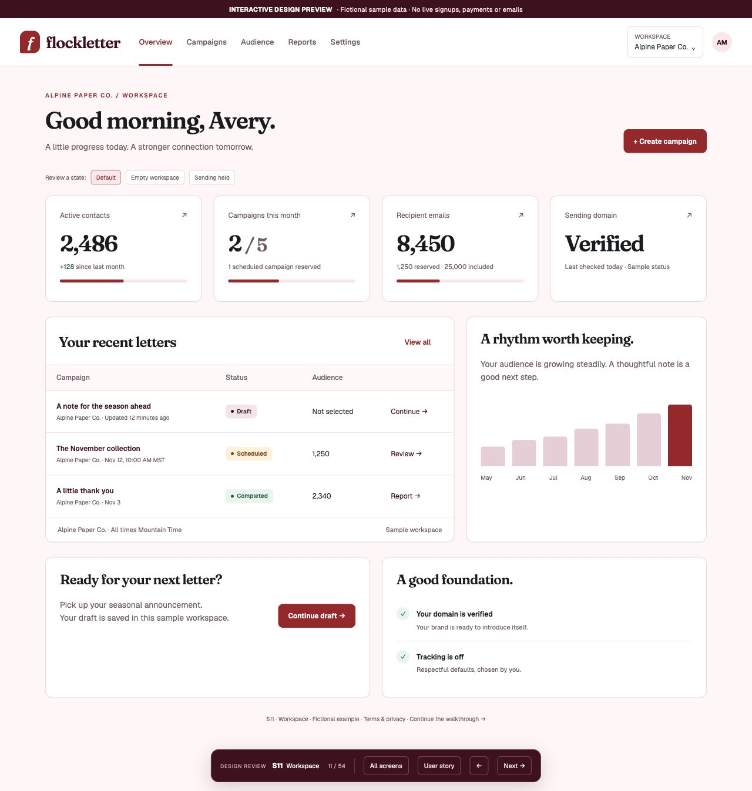

# Flockletter design review

**[Open the interactive Sites prototype](https://flockletter-design-review.alandmunro.chatgpt.site/#dashboard)** · [All 54 screen mockups](SCREENS.md) · [Eight walkthroughs](WALKTHROUGHS.md) · [54 user stories](USER_STORIES.md)

This is the owner-authorized phase-one UI review in Cadence’s visual style. The Sites preview is owner-private; this GitHub folder publicly contains all screenshots and the same static design source. It is not the operational Flockletter service. All records, results and interactions are fictional simulations. No account, payment, email, import, permission grant or Render deployment occurs through it.

## Start here

1. Open the prototype at Overview. Use **All screens** to choose any view.
2. Read **User story** on a screen to understand the role, task, next step, expected outcome and recovery path.
3. Follow **Next** or the visible product action through a journey. State controls expose empty, blocked, uncertain and failure examples.
4. Read the walkthroughs below for end-to-end business scenarios. Record feedback using a screen ID such as **S28** and story ID such as **FL-ST-028**.

| Review journey | Start | What to look for |
| --- | --- | --- |
| Become a customer | [Home](https://flockletter-design-review.alandmunro.chatgpt.site/#home) | Pricing, Clerk Google/Apple/Microsoft/email-code sign-in, card-required trial and guided setup |
| Build an audience | [Audience](https://flockletter-design-review.alandmunro.chatgpt.site/#contacts) | Consent declaration, import review, suppression and list management |
| Prepare and send a letter | [Campaigns](https://flockletter-design-review.alandmunro.chatgpt.site/#campaigns) | Editor, recipient exclusions, test, preflight, authorization and outcomes |
| Work as a team | [Team](https://flockletter-design-review.alandmunro.chatgpt.site/#team) | Clerk membership, seats and separate edit/send/billing capabilities |
| Manage the subscription | [Billing](https://flockletter-design-review.alandmunro.chatgpt.site/#billing) | Pooled allowance, plan changes, failed payments, cancellation and export |
| Read a newsletter | [Subscriber signup](https://flockletter-design-review.alandmunro.chatgpt.site/#subscribe) | Login-free confirmation, preferences, unsubscribe and expired links |
| Connect a tool | [Integrations](https://flockletter-design-review.alandmunro.chatgpt.site/#integrations) | Scoped, revocable access and explicit send authority |
| Operate the service | [Platform overview](https://flockletter-design-review.alandmunro.chatgpt.site/#platform) | Separate authority, recovery, support escalation and complimentary FFA |

The signup journey uses the capped trial example. The populated audience, campaign and billing journeys use a separate paid Tier 2 example. Screen navigation does not upgrade a trial or change fixture records; see the walkthrough introduction for that distinction.

## What is included

- 54 primary screen families covering public, account, onboarding, customer, subscriber and operator experiences.
- Desktop screenshots for every screen, eight representative phone screenshots and three critical failure-state captures.
- An interactive browser-local prototype with catalogue/story navigation, filters, sample editing, confirmations and recovery examples.
- Stable screen/story IDs mapped to SRD requirements, plus a documented [visual system](DESIGN_SYSTEM.md) and [design verification](VERIFICATION.md).
- The owner-supplied Frosty Flamingo Software logo in the upper-right header across all screen families, with responsive sizing.
- Approved $15/$25/$39 tier values, 2,500-contact/2,500-email trial limits and Clerk-owned workspace memberships, with the four approved launch sign-in methods.

## Review boundaries

Actual Clerk/Stripe surfaces are represented as explicit handoff mockups; they are not connected provider components. The editor, imports, analytics, support, billing and permissions are conceptual demonstrations, not functional backend features. Prototype navigation can jump between roles and states solely to support review.

Unresolved policies remain visible: trial campaign/seat/company/brand caps, usage anchors and rollover, exact role matrix, billing adaptation, delivery/trust policy, retention exceptions, FFA’s assigned tier and support automation details. The 90-day retention duration is accepted; a sample date does not approve its clock. See [the decision ledger](../DECISIONS.md).

## Open the mockup without Sites

Download or clone the repository and open [prototype/index.html](prototype/index.html) in a browser. Its adjacent CSS and JavaScript provide browser-local navigation and sample interactions. This artifact has no build step, packages, credentials, APIs, database or deployment workflow. Online fonts are optional; system fallbacks work when they cannot load. The Sites hosting manifest and source credentials are intentionally absent from this public copy.

## Review images

[Dashboard screenshot](screenshots/S11-dashboard.jpg) · [Pricing screenshot](screenshots/S02-pricing.jpg) · [Campaign editor](screenshots/S25-campaign-editor.jpg) · [Reader signup](screenshots/S43-subscribe-mobile.jpg)

The next gate is owner review of these designs and unresolved product decisions. Application implementation remains unauthorized.
